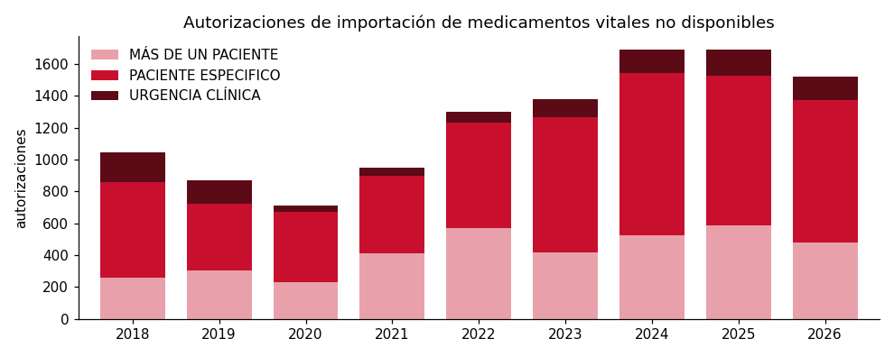
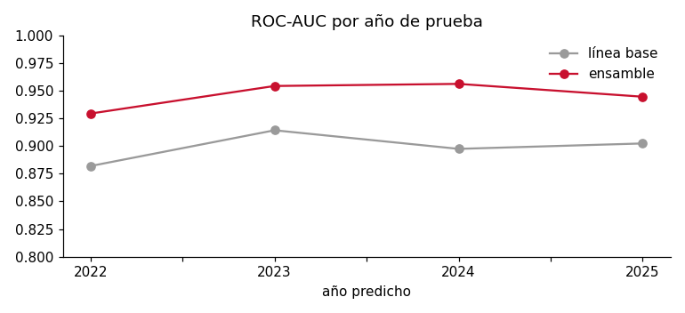

# Radar de desabastecimiento de medicamentos · Colombia

**¿Qué medicamento va a faltar el próximo año?** Un modelo de machine learning, construido con datos abiertos del INVIMA, que anticipa qué moléculas tendrán que importarse de emergencia como *medicamento vital no disponible* en los próximos 12 meses.

**Demo:** https://radar-medicamentos.vercel.app · **Análisis completo:** [`notebooks/analisis.ipynb`](notebooks/analisis.ipynb)



## Por qué importa

Cuando un medicamento falta en Colombia, el INVIMA autoriza importarlo como *vital no disponible*. Desde 2018 hubo **11.155 autorizaciones** para 591 moléculas, y el ritmo se duplicó: 2024 y 2025 son los años más altos de la serie. **196 de esas moléculas tienen registro sanitario en el país**: existen en el mercado y aun así faltaron.

## Datos

| Fuente (datos.gov.co) | ID | Filas |
|---|---|---|
| Medicamentos vitales no disponibles (INVIMA) | `sdmr-tfmf` | ~11.000 autorizaciones, 2018–2026 |
| Código Único de Medicamentos vigentes (INVIMA) | `i7cb-raxc` | ~157.000 presentaciones |
| Código Único de Medicamentos vencidos (INVIMA) | `vwwf-4ftk` | ~153.000 presentaciones |

## Método

1. **Normalización** de nombres de moléculas (sales, hidratos, `EQUIVALENTE A`, orden de palabras, combinaciones) para cruzar ambas fuentes.
2. **Panel temporal:** para cada 31 de diciembre (2018–2024) se reconstruye el mercado de cada molécula *solo con lo conocido hasta esa fecha*: presentaciones y titulares activos, concentración (HHI), proporción importada, registros perdidos y nuevos, historial en la lista y **contagio terapéutico** (desabastecimientos de otras moléculas del mismo grupo ATC).
3. **Etiqueta:** ¿la molécula entra a la lista en los 12 meses siguientes?
4. **Modelos (scikit-learn):** regresión logística, `HistGradientBoostingClassifier` y un ensamble de rangos.
5. **Validación de origen móvil** sobre cuatro años (2022–2025), siempre entrenando solo con el pasado, contra una línea base de persistencia.

## Resultados (promedio de 4 años de prueba)

| Modelo | ROC-AUC | Average precision | Recall top 100 | AUC casos nuevos |
|---|---|---|---|---|
| Línea base (persistencia) | 0.899 | 0.608 | 0.749 | 0.500 |
| Regresión logística | 0.946 | 0.575 | 0.745 | 0.744 |
| Gradient boosting | 0.940 | 0.514 | 0.780 | 0.717 |
| **Ensamble (final)** | 0.946 | 0.602 | 0.776 | 0.743 |



**Lectura honesta:** el desabastecimiento es crónico (77 % de los casos de un año ya estuvieron antes en la lista), así que la persistencia es una línea base muy fuerte y casi imbatible en el top 20. El ensamble la supera en **todos** los años en ROC-AUC y recall, y su aporte principal está en los **casos nuevos**: ahí la persistencia no distingue nada (AUC 0,5) y el modelo llega a ≈0,74.

## Hallazgos

- **Es crónico:** tres de cada cuatro moléculas que necesitarán importación de emergencia ya estuvieron en la lista.
- **Faltan los genéricos esenciales, no los raros:** las moléculas que entran tienen en promedio ~5 titulares activos frente a ~2,7 del resto (lidocaína, cloruro de potasio, metotrexato): alto uso, bajo margen.
- **Contagio por clase terapéutica:** si otras moléculas del mismo grupo ATC estuvieron en la lista, la tasa de entrada se triplica (3,0 % vs 0,95 %).

## Cómo correrlo

```bash
make setup      # entorno virtual + dependencias
make all        # descarga → variables → entrenamiento → exportación → notebook
cd web && npm install && npm run dev
```

## Estructura

```
src/
  download.py    descarga los datasets desde la API de datos.gov.co
  normalize.py   normalización de nombres de moléculas
  features.py    panel molécula × fecha de corte (sin fuga de información)
  train.py       modelos, validación de origen móvil, importancia y ranking actual
  export.py      JSON para la web
notebooks/analisis.ipynb   análisis completo con gráficos y conclusiones
web/                       sitio interactivo (React + Vite + Recharts + Motion)
```

## Limitaciones

- La lista de vitales no disponibles es un *proxy*: mide importaciones autorizadas, no todo el desabastecimiento.
- El CUM no incluye volúmenes de venta; cruzar con SISMED (precios y unidades) es el siguiente paso.
- ~24.000 presentaciones inactivas no tienen fecha de inactivación y se excluyen de los conteos.
- Con ~15 casos nuevos por año, las métricas de esos casos tienen alta varianza. El radar sirve para **priorizar vigilancia**, no para decisiones clínicas.

---

Análisis independiente con datos públicos; no es una fuente oficial del INVIMA. Hecho por [David Troya](https://davidtroya.vercel.app).
